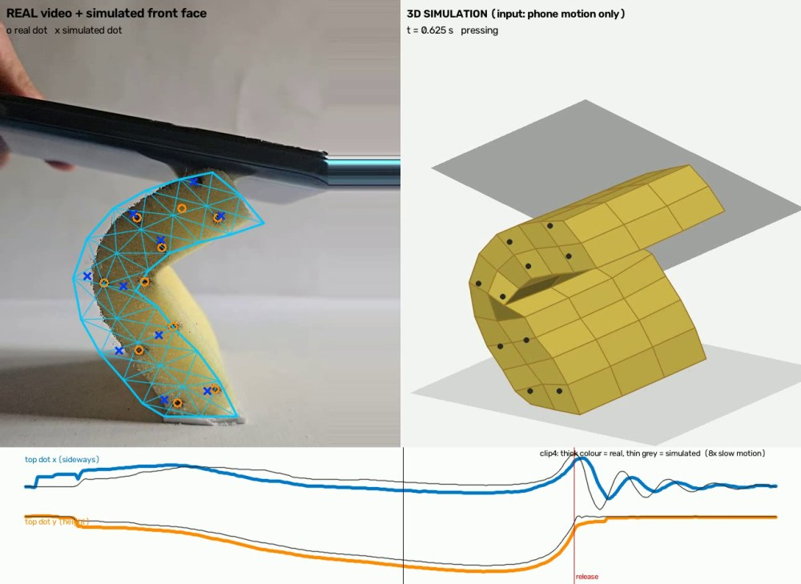
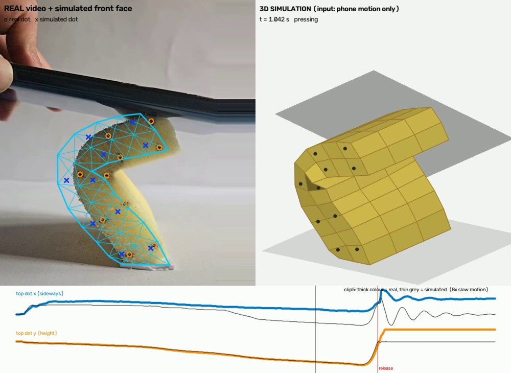
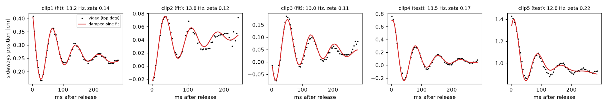
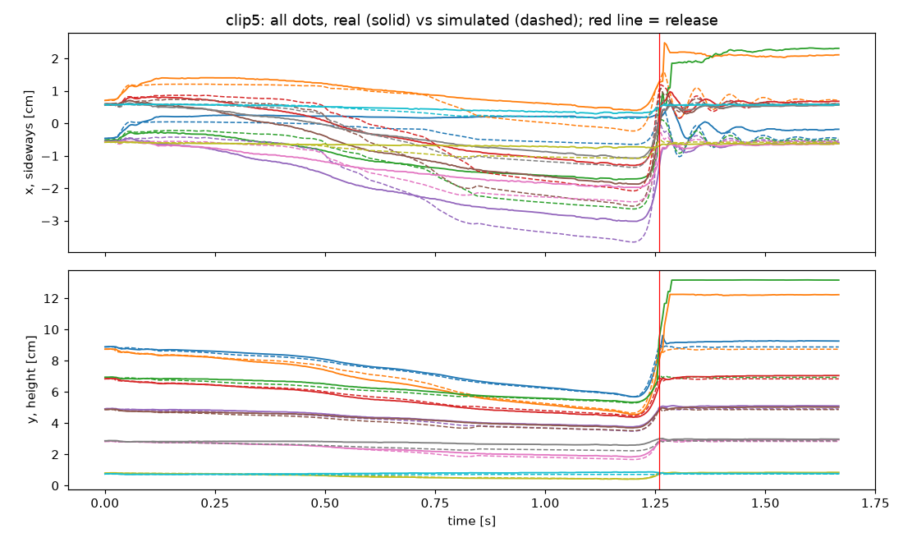
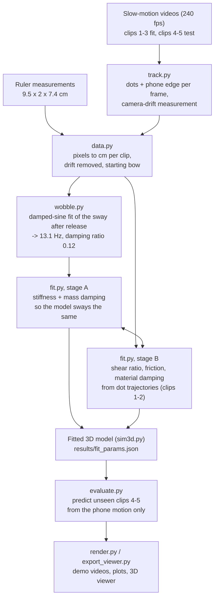

<div align="center">


# Sponge 3D Sim

*Film a sponge. Fit its physics. Predict the next squish.*

[Results](#results-at-a-glance) · [Pipeline](#pipeline) · [Quick Start](#quick-start) · [Approach](#approach) · [Limitations](#limitations-and-what-went-wrong-along-the-way)

Sponge 3D Sim learns how a foam sponge deforms from **240 fps slow-motion video** of it being pressed and released. Tracked marker dots and the presser's motion drive a **3D mass-spring model** with volume preservation, **Rayleigh damping** and **frictional contact**. Its **effective stiffness and damping** are read off the sponge's free sway after release (**13.1 Hz**, damping ratio **0.12**), and its bending and friction are fitted to the dot trajectories. The fitted model then **predicts presses it has never seen** from the presser's motion alone, to within **0.34 / 0.36 cm** on two held-out videos. Everything is scripted, from tracking to the demo videos and an **interactive 3D viewer**, and runs on a laptop CPU.

**Live:** [rishab-panwar.github.io/sponge-3d-sim](https://rishab-panwar.github.io/sponge-3d-sim/)

</div>

| | |
|---|---|
| Object | Foam sponge strip, 9.5 × 2.0 × 7.4 cm (height × width × depth), base taped to the table |
| Interaction | Phone pressed down on the top until the strip buckles sideways, then lifted off |
| Capture | Redmi Note 9 Pro Max, 240 fps slow motion, 1080 × 1920, side view (camera drift compensated), 10 ink dots on the visible face |
| Model | 3D mass-spring grid (3 × 11 × 4 nodes) with tetrahedral volume preservation, Rayleigh damping, phone as a moving rigid plate with Coulomb friction |
| Fitted | Sway frequency **13.14 Hz**, damping ratio **0.116** (from the video); shear/axial ratio, friction and material damping (from the dot trajectories) |
| Test (2 unseen presses) | Dot error **0.34 cm** (clip 4) and **0.36 cm** (clip 5) RMS, dots move up to ~4 cm; predicted sway 13.14 Hz vs **13.47 / 12.84 Hz** measured |

**Demo:** [`results/demo/clip4.mp4`](results/demo/clip4.mp4) and [`results/demo/clip5.mp4`](results/demo/clip5.mp4) are the held-out test clips: the real video with the simulated front face drawn on top, the 3D simulation next to it, and live real-vs-simulated traces (8× slow motion). An interactive 3D viewer is in [`results/viewer/index.html`](results/viewer/index.html) (open it in a browser).

## Results at a glance

<table>
  <tr>
    <td width="50%" align="center"><b>Test clip 4 (unseen), while pressing</b><br/>
      </td>
    <td width="50%" align="center"><b>Test clip 5 (unseen, recorded after fitting)</b><br/>
      </td>
  </tr>
</table>

<sub>Left half of each image: the real video with the model's front face (blue mesh), real dots (orange circles) and simulated dots (blue crosses). Right half: the 3D model under the phone plate. Bottom: the top dot's sideways and vertical position over time, real (thick) vs simulated (thin). The model only receives the phone's motion.</sub>

**How the video sets stiffness and damping.** After release the sponge sways sideways and settles. A damped sine fits that motion in every clip; its frequency (~13 Hz) and decay are what the model is tuned to:



**All dots over time, test clip 5** (solid = real, dashed = simulated, red line = release):



## Pipeline



---

## Quick start

Python 3.12 on Windows was used; anything recent should work.

```bash
python -m venv .venv
.venv/Scripts/activate            # Linux/macOS: source .venv/bin/activate
pip install -r requirements.txt

cd src
python track.py --overlay   # video -> data/tracks/*.csv            (~3 min; overlays in results/tracking/)
python wobble.py            # measured sway per clip -> results/wobble_measured.json   (seconds)
python fit.py               # fit the 3D model -> results/fit_params.json              (~1 h, 1 core)
python render.py            # demo videos + plots -> results/demo/, results/plots/     (~5 min)
python export_viewer.py     # interactive viewer data -> results/viewer/data.js
python make_page.py         # comparison charts + web (H.264) videos for index.html (the results page)
```

Every step reads the previous step's output, and all outputs are committed, so any step can be run on its own. For example, `python render.py clip4` re-renders the test clip from the committed parameters without refitting.

### Testing on a new video (no refitting)
The fitted parameters are saved in `results/fit_params.json`, so a fresh press can be predicted and scored in about a minute:

1. Record it with the same setup (side view, same sponge with its 5 × 2 dots, phone pressing from the top, plain background) and put it in `data/raw/`, e.g. `clip6.mp4`.
2. Add it to `data/clips.json`: `"clip6": {"file": "raw/clip6.mp4", "capture_fps": 240, "role": "test"}`. `capture_fps` is the real slow-motion rate; the file itself plays at ~30 fps.
3. Run, from `src/`:
   ```bash
   python track.py clip6 --overlay   # check results/tracking/clip6_overlay.mp4 to see the tracking worked
   python evaluate.py clip6          # dot error + measured vs predicted sway -> results/evaluation.json
   python render.py clip6            # demo video + plot
   ```

This was checked from a clean copy of the repository and a fresh environment, treating clip 4 as a new video: the tracking output was byte-for-byte identical and the errors matched.

## Repository layout

```
data/
  raw/clip1-5.mp4        input videos (240 fps slow motion, saved for playback at ~30 fps)
  clips.json             per clip: file, real capture fps, role (fit / test), use_trajectory
  sponge.json            measured dimensions (cm)
  measurements/          ruler photos for those dimensions
  tracks/                tracker output: per-frame dot and phone positions (+ _meta.json)
src/
  track.py               dot + phone tracking (OpenCV)
  data.py                pixel -> cm conversion, per-clip calibration, phone input smoothing
  wobble.py              damped-sine fit of the free sway (frequency, damping ratio)
  sim3d.py               the 3D model (used for all results)
  sim.py                 the 2D side-view model (development model; shares Params)
  fit.py                 two-stage fit
  evaluate.py            score any clip with the saved fitted model (no refitting)
  render.py              demo videos and plots
  export_viewer.py       data for the interactive viewer
results/
  fit_params.json        fitted parameters and all error numbers (3D)
  fit_params_2d.json     the same for the 2D development model
  fit_log*.txt           fit logs
  wobble_measured.json   measured sway per clip
  demo/  plots/  viewer/
```

## Capture

- The strip stands on its 2 × 7.4 cm end, taped to the table, in front of a plain background. The camera looks at the 2 cm face, level with the sponge.
- 10 ink dots (5 rows × 2 columns) on that face serve as markers.
- The phone is pressed down on the top, which makes the strip buckle sideways, and is then lifted off. Five takes at different depths: clips 1–3 for fitting, **clips 4 and 5 held out as tests** (clip 5 was recorded after the model was fitted).
- Videos were copied at full resolution (Google Drive). An earlier set sent through a messenger was compressed to 478 × 850 and was replaced.
- Ruler measurements: height 9.5 cm, width 2.0 cm, depth 7.4 cm (photos in `data/measurements/`). The sponge was not weighed, see [Units](#units-stiffness-is-per-unit-mass).

## Approach

### 1. Tracking (`track.py`)
For every frame:
- **Sponge**: HSV colour threshold for the yellow foam, keeping the largest blob.
- **Dots**: a black-hat filter (local darkness) is Gaussian-blurred to dot scale and its peaks are taken. This finds dots even where they touch the shaded edge of the foam. Dot identities are fixed in the first frame using the grid layout, then followed with pyramidal Lucas–Kanade optical flow, snapping to the nearest detected dot. A position is marked *verified* when it lands on a detected dot (87–99 % of dot-frames, depending on the clip).
- **Phone**: the largest dark blob. Its bottom edge is fitted as a line (height and tilt), and its far end gives its sideways position.
- **Touch-down and release**: the gap between the phone edge and the sponge top is noisy frame to frame but sits at a constant offset during contact and jumps at release. Both events are detected on a median-smoothed gap.

- **Camera drift**: the phone on its stand was nudged during some presses (up to 0.9 cm in clip 5, 0.7 cm in clip 3). Each frame's shift relative to frame 0 is measured by phase correlation on the static strip around the taped base (tape, shadow, table) and subtracted from everything tracked (`data.py`).

Detection runs at a fixed working width (480 px); positions are saved in original-video pixels. The marker layout (5 × 2, evenly spaced rows) is given in `data/sponge.json`; the tracker picks the most evenly spaced grid among the detections, which rejects stray dark spots such as the phone's shadow on the top or the tape edge at the base (needed for clip 5).

### 2. Calibration (`data.py`)
The camera distance changed between takes, so **each clip is scaled separately**: its resting sponge height (before the phone touches) equals 9.5 cm. As a check, the dot grid then measures 8.1–8.2 cm tall in all four clips. The tracked phone pose is lightly smoothed (Savitzky–Golay, 9 frames = 37 ms); the reason is explained below.

### 3. The model (`sim3d.py`)
- **Body**: 3 × 11 × 4 nodes spanning 2 × 9.5 × 7.4 cm, total mass 1. Springs run along every cell edge (axial stiffness `k_axial`) and every face and body diagonal (shear stiffness `k_shear`). Each cell is split into 6 tetrahedra whose **signed volume** resists change. Springs alone only see lengths, so a pure spring grid can turn a cell inside out and stay stuck in that shape; in the 2D version this was the main early failure (see below).
- **Damping**: Rayleigh damping, i.e. a dashpot on every spring (`zeta`, resists the rate of deformation) plus mass-proportional damping (`alpha`, resists the speed of motion).
- **Base**: the bottom layer is pinned (taped).
- **Starting shape**: the strip is never perfectly straight. Before contact it already bows slightly to one side (0.02–0.24 cm, varying between takes). That bow is measured in each clip before the phone touches and used as that clip's stress-free shape. It acts as the *imperfection* that decides which way the column buckles, and the real sponge buckled the same way in every take.
- **Driving input, the only input**: the phone is a rigid plate whose height, tilt and sideways position come from the tracking. The contact is one-sided (it can push, never pull), with Coulomb friction `mu`. The table is a second one-sided contact.
- **Dots** are material points on the front face, so the simulated dots are compared directly with the tracked ones.
- Semi-implicit Euler time stepping, compiled with Numba. One clip takes 3–6 s.

### 4. Fitting (`fit.py`, `wobble.py`)
The dynamic information is concentrated in about 0.25 s after release, when the top sways sideways a few times and settles. The press itself is slow and mostly constrains the *shape* parameters. So the fit has two stages.

**Stage A, stiffness and damping from the sway.** `wobble.py` fits a damped sine plus a slow drift to the top dots' sideways motion after release. It fits all four clips well (residuals 0.005–0.016 cm):

| clip | frequency | damping ratio | sway amplitude |
|---|---|---|---|
| clip1 (fit) | 13.2 Hz | 0.14 | 0.17 cm |
| clip2 (fit) | 13.8 Hz | 0.12 | 0.06 cm |
| clip3 (fit) | 13.0 Hz | 0.11 | 0.17 cm |
| clip4 (test) | 13.5 Hz | 0.17 | 0.63 cm |
| clip5 (test) | 12.8 Hz | 0.22 | 0.44 cm |

(values after camera-drift compensation, `results/wobble_measured.json`.) The frequency agrees within about ±4 % across five takes; the damping ratio is noisier (0.11–0.22), as usual. The amplitude-weighted means over clips 1–3 (**13.14 Hz, ζ = 0.116**) are the targets. The model is "plucked" virtually (sideways velocity, no phone) and measured with the same damped-sine fit. `k_axial` is rescaled (frequency ∝ √stiffness) and `alpha` adjusted (ζ ≈ α / 2ω) until it sways at exactly the target values.

**Stage B, shape parameters from the trajectories.** With Stage A re-solved inside the loop, the shear/axial ratio, `mu` and `zeta` are fitted to the dot trajectories of clips 1 and 2 (coarse grid, then Nelder–Mead in log space). The loss per clip is the mean squared dot error *while pressing* plus the mean squared error *during the first 0.25 s after release*, each averaged separately so the long press does not drown out the short free phase. Stages A and B alternate twice.

Clip 3's sway is used in Stage A, but its trajectories are not used in Stage B. In clip 3 the sponge folds onto itself, which the model cannot represent (no self-contact), and its simulation is chaotic (a 6 % parameter change moved its error from 0.46 to 9 cm in 2D). It is reported as a stress test.

### 5. Evaluation (`evaluate.py`)
Clips 4 and 5 are never used in either stage. The model receives only their tracked phone motion and their starting shape from the frames before contact, and predicts every dot for the whole clip.

**Note on the order of work:** the parameters were fitted *before* camera-drift compensation was added (it was found while testing clip 5). With compensation, the fitting clips' errors barely changed (0.46 / 0.28 cm, previously 0.46 / 0.26), so the model was not refitted for lack of time; the error table below is computed on the compensated data (`results/evaluation.json`).

## Results

Fitted 3D parameters (per unit mass, see [Units](#units-stiffness-is-per-unit-mass)): `k_axial` = 5e+04, `k_shear` = 2.09e+04 (cm/s² per unit strain, per unit mass), `zeta` = 0.80, `alpha` = 13.0 1/s, `mu` = 1.64.

Effective behaviour: **sway 13.14 Hz, damping ratio 0.116**; shear/axial stiffness ratio 0.42; phone–foam friction μ ≈ 1.6.

Dot error (RMS distance between simulated and tracked dots, verified dot positions only):

| clip | role | overall | while pressing | first 0.25 s after release | max |
|---|---|---|---|---|---|
| clip1 | fit | 0.46 cm | 0.53 | 0.25 | 1.58 |
| clip2 | fit | 0.28 cm | 0.30 | 0.17 | 0.91 |
| clip4 | **test (unseen)** | **0.34 cm** | 0.38 | 0.22 | 0.95 |
| clip5 | **test (unseen, recorded after fitting)** | **0.36 cm** | 0.38 | 0.28 | 1.19 |
| clip3 | stress test (self-fold; not used in Stage B) | 0.46 cm | 0.50 | 0.29 | 1.13 |

For scale: the dots move by up to ~4 cm during the press and ~0.6 cm during the sway.

- **Prediction on the unseen test presses (clips 4 and 5)**: the bending shape, the release and the free sway are reproduced; see `results/plots/clip4_traces.png`, `clip5_traces.png` and the demo videos. The sway predicted from the fitting clips (13.14 Hz) is within 2.5 % of the measured 13.47 Hz (clip 4) and 12.84 Hz (clip 5). The test clips' damping (0.17, 0.22) is above the fitted 0.116: the model under-damps those swings, which is visible as slightly longer ringing after release.
- **The 2D model** (side view, same method, `results/fit_params_2d.json`) gives almost the same errors on clips 1, 2 and 4 (test 0.33 cm), but fails on clip 3 (1.58 cm vs 0.53 cm in 3D). That is expected: the strip deforms uniformly through its depth, so the side view captures it well. The 3D model adds the out-of-plane geometry and a full 3D state.
- **Robustness** (each parameter changed by ±5 %, `fit.py` values): all clips stay within 0.01 cm of their errors (clip1 0.46–0.47, clip2 0.26, clip4 0.34–0.35 cm; `results/robustness_3d.json`). The 2D model was less stable: there clip 1 switched buckling direction in 3 of 10 such tests (error 0.45 → 1.2–1.5 cm).

## What the model can and cannot capture

**Can:**
- Large bending and buckling under a moving, tilting, sliding presser, including which way it buckles.
- Free recovery after release, with the right sway frequency and decay.
- Friction-driven drag of the top by the phone.
- Prediction of a new press from the presser motion alone.

**Cannot / assumptions:**
- **Linear springs, homogeneous material.** No stiffening when foam is crushed (densification), no direction-dependent foam properties.
- **No self-contact.** When the strip folds onto itself (clip 3), the halves can pass through each other.
- **No slow creep.** The real sponge creeps back slowly over seconds after release; the model is elastic with damping only. (An apparent 0.7 cm permanent shift in clip 3 turned out to be camera drift, not the sponge.)
- **Uniform through the depth.** The phone is assumed to press evenly along the 7.4 cm depth; nothing in the video shows the depth direction, so 3D effects along it are assumed, not observed.
- **Contact normal taken as vertical** (the phone tilts up to ~12°); the phone is not tracked along the depth direction.
- **Buckling direction relies on the measured starting bow.** Like a real column at its buckling load, small imperfections decide which way it buckles. The 3D fit is robust to ±5 % parameter changes, but the 2D model was not (clip 1, see Results), and a sponge with no measurable starting bow would be hard to predict.

## Units: stiffness is per unit mass
The video gives positions over time but never forces, so stiffness and mass cannot be separated: only stiffness/mass (which sets the 13 Hz sway) is observable. The model therefore uses total mass = 1, and `k_axial`, `k_shear` are "stiffness per unit mass". Weighing the sponge would turn them into N/m directly (multiply by the mass). The damping ratio, friction coefficient and frequency are dimensionless or physical as they stand.

## Limitations and what went wrong along the way
- **Release speed.** I first tried to capture the spring-back by lifting the phone quickly, but the foam recovers vertically in ~20 ms, as fast as a hand can lift, so the top always follows the phone up. The free motion that *is* visible is the sideways sway, which became the basis of Stage A.
- **Spring grids invert.** The first (2D) model got stuck folded after release: grid cells had turned inside out. Adding the signed-area (2D) / signed-volume (3D) term fixed it (test error 1.03 → 0.41 cm in 2D).
- **Fitting trajectories alone gives the wrong stiffness.** Fitting only the dot paths produced a model that swayed at 43 Hz instead of 13 Hz with almost no damping: a squared-error loss on an oscillation prefers a small, fast jitter to a slightly mistimed wobble. Fitting the sway's frequency and decay directly (Stage A) fixed this.
- **Wrong guesses.** When the 13 Hz model first fitted the press badly, I blamed the damping type, then a compliant base (I tested base springs; they lowered the sway frequency but hurt the press just as much). Both were wrong. The actual causes were tracking jitter in the phone inputs, which flipped the simulated buckling direction, together with clip 3's chaotic behaviour misleading the grid search. Smoothing the inputs and removing clip 3 from Stage B fixed it. The base-spring option is still in `sim.py`/`Params` but switched off.
- **Tracking.** The top-left dot sometimes slides onto the phone's edge while it presses there (visible as a jump in clip 4 at ~0.08 s). The sponge outline is ~8 % narrower in the video than the measured 2 cm (fuzzy, shaded edges), so the simulated face looks slightly wider in the overlay.
- **Two test presses.** Clips 4 and 5 are a small test set; more fresh presses would make the validation stronger. The damping ratio varies between takes (0.11–0.22), so a single fitted value is an average.
- **Camera drift was found late.** It was discovered while testing clip 5 and corrected for all clips, but the parameters were not refitted afterwards (see Evaluation).

## Credits
- [OpenCV](https://opencv.org/) (tracking, video I/O), [NumPy](https://numpy.org/), [SciPy](https://scipy.org/) (`curve_fit`, Nelder–Mead, Savitzky–Golay, median filter), [Numba](https://numba.pydata.org/) (compiled simulation loop), [Matplotlib](https://matplotlib.org/) (plots), [three.js](https://threejs.org/) (interactive viewer, loaded from a CDN).
- Methods used are standard: mass-spring lattices, signed-volume (inversion-preventing) terms, Rayleigh damping, Lucas–Kanade optical flow, damped-sine system identification, initial imperfections in buckling analysis.
- AI tool: this project was developed with the help of [Claude Code](https://claude.com/claude-code) (Anthropic), used for writing and debugging code.
